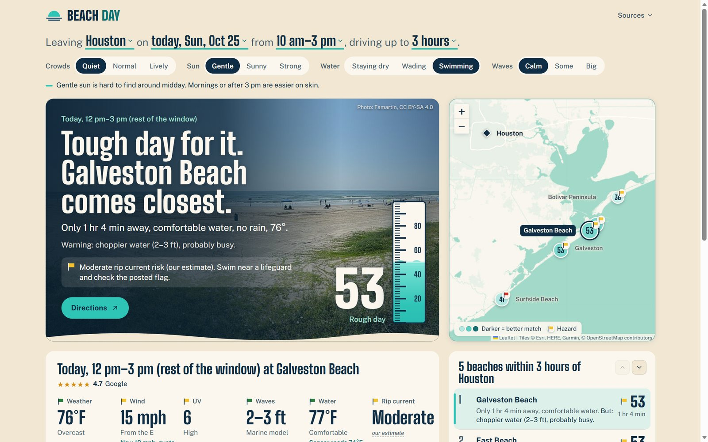
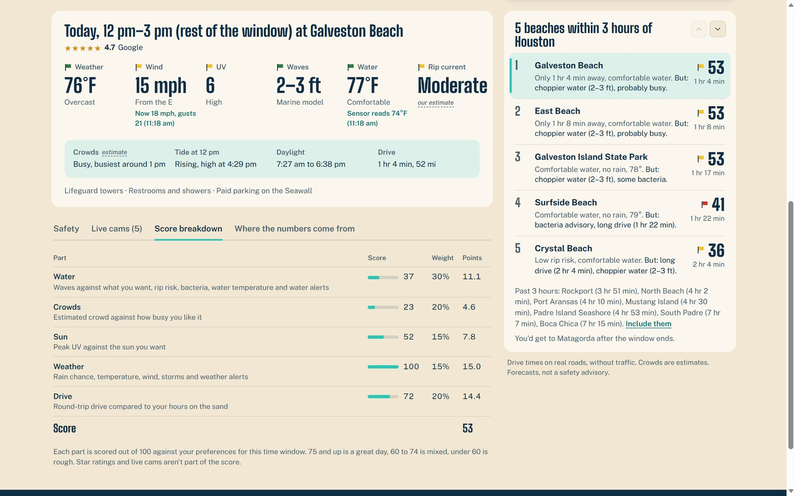
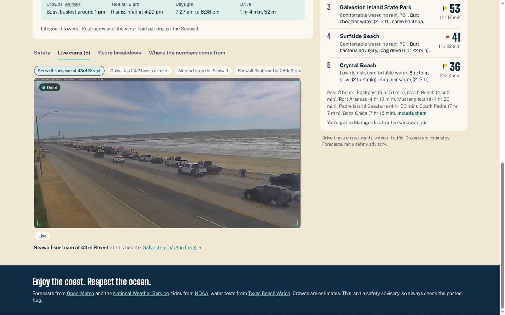
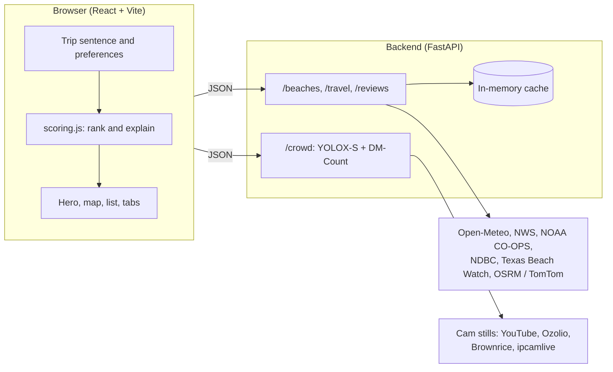

# Beach Day

**Find the best Texas beach for your day.** Beach Day ranks 13 Texas Gulf Coast beaches for the day, time window and kind of beach trip you want. It scores each one with live public data: weather, waves, rip currents, water quality, tides, drive times and crowds. It also counts crowds on live beach cams with computer vision.




---

## Why we built it

Choosing a beach on the Texas coast means checking a weather app, a surf report, the NWS rip current forecast, bacteria test results, tide tables and a map, then guessing how crowded it will be. None of these sources talk to each other, and none of them know what *you* want from the day. A family wading with small kids and a surfer chasing waves should get different answers on the same morning.

Beach Day pulls all of that into one ranked answer, explained in plain language:

> Leaving **Houston** on **Saturday**, from **10 am–3 pm**, driving up to **2 hours**.
>
> **Galveston Island State Park is your best bet.** Flat, calm water, likely quiet, only 1 hr 17 min away. But: strong sun.

## Features

- **Personal ranking.** Pick a starting city (or use your location), a day up to 16 days out, a time window and a drive limit. Then set your preferences for crowds, sun, getting in the water and waves. Every reachable beach gets a 0–100 score.
- **Score breakdown.** See each part of the score, its weight and the points it adds, so a number never appears out of nowhere.
- **Safety first.** NWS alerts, bacteria advisories, rip current risk, thunderstorm and UV warnings always show, whatever the score. Each beach gets the lifeguard flag color its forecast points to.
- **Live conditions.** While your window is under way, readings from NOAA water sensors and NDBC wave buoys appear next to the forecast.
- **Interactive map.** Score circles are colored on one scale, hazards get a flag badge, and beaches out of range show as muted dots.
- **Live cams with AI crowd levels.** 12 live cams across 5 beaches play on the page. A computer vision pipeline on the server labels each one Quiet, Moderate or Busy.
- **Transparent sources.** A tab lists where every number comes from and marks which are official, measured, forecast or estimated.
- **Responsive.** Works on phones, tablets and desktops, and respects reduced-motion settings.

<p>
  
  
</p>

## How it works



- **The backend gathers the data.** It requests every source in parallel with async httpx and caches the results in memory. The forecast is cached for 30 minutes, water quality for 1 hour, drive times for 24 hours and AI counts for 10 minutes. Each source's status is reported to the Sources menu in the header.
- **The browser does the scoring.** Changing a preference re-ranks the beaches instantly, with no new request to the server.
- **Each beach gets five part scores:** water 30%, crowds 20%, drive 20%, sun 15% and weather 15%. A beach loses up to 30 more points when the round-trip drive is longer than your time on the sand.
- **AI crowd counting.** The browser can't read pixels from another site's video player, so the backend fetches a still frame from each cam itself. Two models run on it on the CPU:
  - **YOLOX-S** detects individual people.
  - **DM-Count** estimates crowd density, which works better on dense crowds.

  The frame is split into overlapping tiles so distant people stay visible, and duplicate detections are merged with non-maximum suppression.

The full write-up, with every data source and design challenge, is in [PROJECT_NOTES.md](PROJECT_NOTES.md).

## Tech stack

| Layer | Tools |
|---|---|
| Frontend | React 19, Vite, Leaflet and react-leaflet, plain CSS with design tokens, oxlint |
| Backend | Python 3.11, FastAPI, httpx (async), uv |
| Computer vision | ONNX Runtime (YOLOX-S), LiteRT (DM-Count), NumPy, Pillow |
| Data | Open-Meteo, National Weather Service, NOAA CO-OPS, NDBC buoys, Texas Beach Watch (ArcGIS), OSRM, TomTom, Google Places, Yelp Fusion |
| Map and media | Esri World Light Gray Base tiles, Wikimedia Commons photos, embedded live cam players |

## Getting started

### Prerequisites

- [Node.js](https://nodejs.org) 20.19+ or 22.12+ (includes npm)
- [uv](https://docs.astral.sh/uv/), the Python package manager. It installs Python 3.11 for you if you don't have it.
  - Windows: `winget install astral-sh.uv`
  - macOS and Linux: `curl -LsSf https://astral.sh/uv/install.sh | sh`

No API keys are needed. See [Optional API keys](#optional-api-keys) below.

### 1. Clone the repo

```bash
git clone https://github.com/bowenleng/Beach-Day-Planner-App.git
cd Beach-Day-Planner-App
```

### 2. Start the backend

```bash
cd backend
uv run fastapi dev main.py
```

The API runs at http://127.0.0.1:8000, with interactive docs at http://127.0.0.1:8000/docs. `uv run` creates the virtual environment and installs the dependencies on the first run.

The first time a cam is analyzed, the backend downloads the two vision models (about 120 MB) into `backend/models/`. That first count takes a minute; later counts take a few seconds.

### 3. Start the frontend

In a second terminal:

```bash
cd frontend
npm install
npm run dev
```

Open http://localhost:5173. The page reloads automatically when you edit files in `frontend/src`.

**On Windows**, `./run-dev.ps1` from the repo root opens both servers in their own PowerShell windows. If PowerShell blocks scripts, run `Set-ExecutionPolicy -Scope Process -ExecutionPolicy Bypass` first.

### Optional API keys

Copy `backend/.env.example` to `backend/.env` and fill in any of these. The app works without all of them.

| Variable | Adds | Without it |
|---|---|---|
| `TOMTOM_API_KEY` | Drive times with live traffic ([free key](https://developer.tomtom.com/)) | Road routing from OSRM, no traffic |
| `GOOGLE_PLACES_API_KEY` | Live Google ratings | Saved ratings from October 2026 |
| `YELP_API_KEY` | Yelp ratings | A link to Yelp |
| `FRONTEND_ORIGINS` | Comma-separated sites allowed to call the API | The local dev servers on ports 5173 and 4173 |

## Building for production

**Frontend.** Build a static site into `frontend/dist/`, which any static host can serve (Netlify, Vercel, GitHub Pages, S3):

```bash
cd frontend
VITE_API_URL=https://your-api.example.com npm run build
npm run preview   # optional: serve the build locally on port 4173
```

`VITE_API_URL` is read at build time, and it defaults to `http://127.0.0.1:8000`. In PowerShell, set it first with `$env:VITE_API_URL = "https://your-api.example.com"`.

**Backend.** Run it in production mode, and allow your frontend's address:

```bash
cd backend
FRONTEND_ORIGINS=https://your-site.example.com uv run fastapi run main.py --host 0.0.0.0 --port 8000
```

The cache lives in memory, so run a single process, or put a shared cache in front if you scale out.

### Frontend scripts

| Command | What it does |
|---|---|
| `npm run dev` | Development server with hot reload on port 5173 |
| `npm run build` | Production build into `dist/` |
| `npm run preview` | Serves the production build on port 4173 |
| `npm run run` | Builds, then previews |
| `npm run lint` | Lints with oxlint |

## API

| Endpoint | Returns |
|---|---|
| `GET /beaches?day=YYYY-MM-DD` | Hourly forecast, tides, surf forecast, alerts, water quality and live readings for every beach (the day defaults to today) |
| `GET /travel?lat=&lon=&day=&hour=` | Drive time and distance from a starting point to every beach; day and hour are optional and used for traffic |
| `GET /reviews` | Google and Yelp ratings |
| `GET /crowd?beach=&cam=` | AI crowd level for one cam |
| `GET /crowd/frame?beach=&cam=` | The exact frame the crowd count ran on |

Full request and response details are in the interactive docs at `/docs` while the backend is running.

## Project structure

```
Beach-Day-Planner-App/
├── backend/
│   ├── main.py            # FastAPI app and endpoints
│   ├── beaches.py         # The 13 beaches: stations, buoys, NWS zones, cams, photos
│   ├── nws.py             # Surf zone forecasts and alerts
│   ├── noaa.py            # Tides, live sensors, buoys
│   ├── water_quality.py   # Texas Beach Watch bacteria results
│   ├── travel.py          # Drive times (TomTom, OSRM, straight-line)
│   ├── reviews.py         # Google and Yelp ratings
│   ├── crowds.py          # Crowd estimate model
│   ├── vision.py          # AI crowd counting (YOLOX-S + DM-Count)
│   └── cache.py           # In-memory cache
├── frontend/
│   └── src/
│       ├── Discover.jsx   # Main page and its data fetching
│       ├── scoring.js     # Scoring, ranking and plain-language copy
│       ├── BeachMap.jsx   # Leaflet map, markers and label layout
│       ├── CrowdVision.jsx# Cam player with the AI crowd level
│       ├── Gauge.jsx      # Tide-gauge score
│       ├── App.jsx        # Header, sources menu, saved preferences
│       ├── data.js        # Cities, time windows, formatting helpers
│       └── index.css      # Styles and color tokens
├── docs/screenshots/
├── PROJECT_NOTES.md       # Full project write-up
└── run-dev.ps1            # Starts both servers on Windows
```

## Limitations and next steps

- The crowd part of the score comes from a model based on the day, season, hour and weather. The AI cam counts are shown on the cams but aren't part of the score yet. Next step: calibrate the counts for each cam and feed them into the score.
- Beach flag colors are read from the forecast. No public feed of the flags actually flying exists.
- Some cam owners, such as HDOnTap's Port Aransas condo cams, don't allow embedding, so those cams aren't included.
- Planned: long-range projections from historical data, trip planning with cost per person and a packing list, and amenities from OpenStreetMap.

## Credits

- Forecasts from [Open-Meteo](https://open-meteo.com/). Surf forecasts and alerts from the [National Weather Service](https://www.weather.gov/beach/). Tides and sensors from [NOAA CO-OPS](https://tidesandcurrents.noaa.gov/) and [NDBC](https://www.ndbc.noaa.gov/). Water tests from [Texas Beach Watch](https://www.texasbeachwatch.com/).
- Map tiles by Esri, with data from HERE, Garmin and [OpenStreetMap](https://www.openstreetmap.org/) contributors.
- [YOLOX](https://github.com/Megvii-BaseDetection/YOLOX) (Apache-2.0) by Megvii and [DM-Count](https://github.com/cvlab-stonybrook/DM-Count) (MIT) by Stony Brook CV Lab.
- Beach photos from Wikimedia Commons and Flickr; each is credited in the app. Live cams belong to their owners and play from their own players.

## Team

Built by **Reid Messer** ([messerdsp](https://github.com/messerdsp)), **Bowen Leng** ([bowenleng](https://github.com/bowenleng)) and **furpz** ([furpz](https://github.com/furpz)).

> Beach Day is a planning aid, not a safety advisory. Always check the posted flag and swim near a lifeguard.
